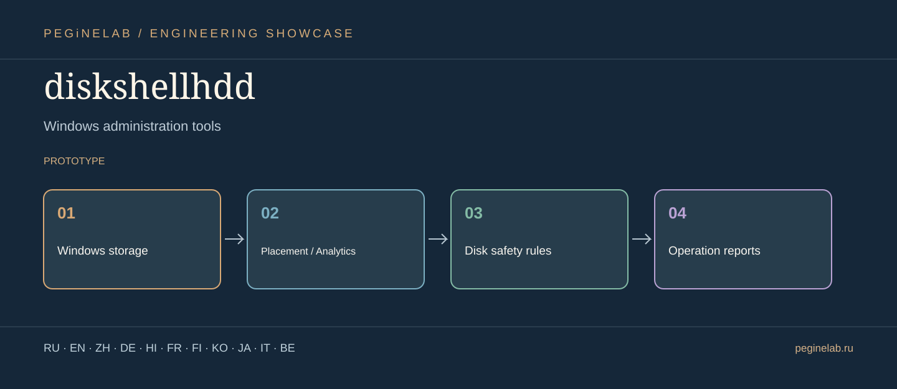

# diskshellhdd · Graphical showcase

**Инструменты системного администрирования Windows / Windows administration tools** · Windows storage → Placement / Analytics → Disk safety rules → Operation reports · status: **prototype**.

**Internationalization scope:** these are translated descriptions, not a claim that the application's UI has eleven implemented languages. Features and limitations in the root README take precedence.

### Русский · ru
Локальная мастерская администрирования накопителей Windows.. **diskshellhdd** — Windows storage → Placement / Analytics → Disk safety rules → Operation reports.

### English · en
Local Windows storage and disk administration workbench.. **diskshellhdd** — Windows storage → Placement / Analytics → Disk safety rules → Operation reports.

### 简体中文 · zh
本地 Windows 磁盘与存储管理工作台。. **diskshellhdd** — Windows storage → Placement / Analytics → Disk safety rules → Operation reports.

### Deutsch · de
Lokale Verwaltungswerkstatt für Windows-Datenträger.. **diskshellhdd** — Windows storage → Placement / Analytics → Disk safety rules → Operation reports.

### हिन्दी · hi
Windows डिस्क और स्टोरेज प्रशासन का स्थानीय कार्यक्षेत्र।. **diskshellhdd** — Windows storage → Placement / Analytics → Disk safety rules → Operation reports.

### Français · fr
Atelier local d'administration des disques sous Windows.. **diskshellhdd** — Windows storage → Placement / Analytics → Disk safety rules → Operation reports.

### Suomi · fi
Paikallinen Windows-levyjen ja tallennuksen hallintatyökalu.. **diskshellhdd** — Windows storage → Placement / Analytics → Disk safety rules → Operation reports.

### 한국어 · ko
로컬 Windows 디스크·스토리지 관리 도구.. **diskshellhdd** — Windows storage → Placement / Analytics → Disk safety rules → Operation reports.

### 日本語 · ja
Windows 管理ツール. **diskshellhdd** — Windows storage → Placement / Analytics → Disk safety rules → Operation reports.

### Italiano · it
Strumenti di amministrazione Windows. **diskshellhdd** — Windows storage → Placement / Analytics → Disk safety rules → Operation reports.

### Беларуская · be
Інструменты адміністравання Windows. **diskshellhdd** — Windows storage → Placement / Analytics → Disk safety rules → Operation reports.

## Contact / Контакты

[Telegram @Feudorlab1](https://t.me/Feudorlab1)

[feudor.lab@yandex.ru](mailto:feudor.lab@yandex.ru) · [obzorniky@gmail.com](mailto:obzorniky@gmail.com) · [peginelab.ru](https://peginelab.ru/)

[Source repo](https://github.com/musikfed/diskshellhdd)
